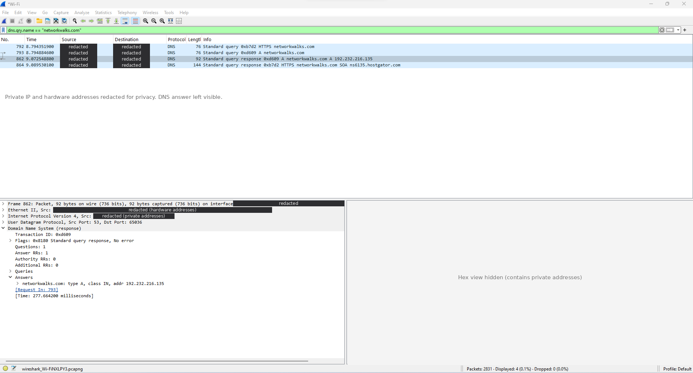
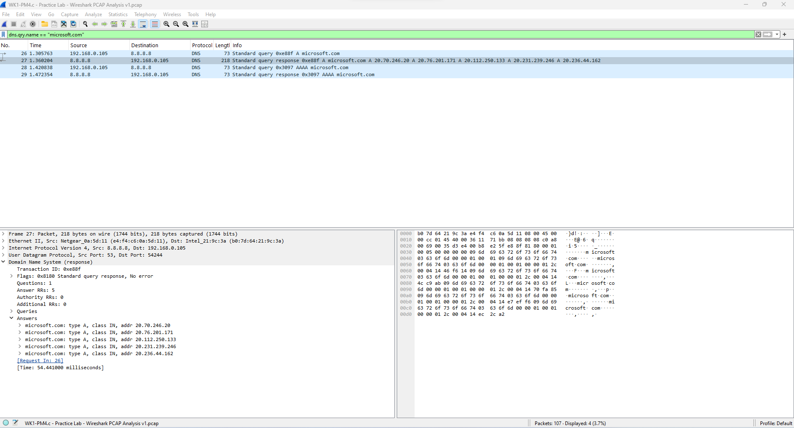

# Wireshark Packet Capture Tasks

Week 1 extra project, Networkwalks internship. Two tasks that read DNS and TLS details from real traffic.

## Task 1: Live capture of my own Wi-Fi traffic
1. Cleared the DNS cache with `ipconfig /flushdns`.
2. Captured on the Wi-Fi adapter while opening a website in an Incognito window.
3. Used these filters:
   - `dns.qry.name == "networkwalks.com"` for the DNS query and answer
   - `tls.handshake.type == 1` for the Client Hello (server name and port)
   - `tls.handshake.type == 2` for the Server Hello (TLS version)

**Findings:** the server name was `networkwalks.com`, the secure connection used port 443, and the server chose TLS 1.3.

## Task 2: PCAP analysis
Opened a saved capture of a browser visiting microsoft.com and read the same details: the client and DNS server addresses, the IPs returned for the name, the server name, port 443 and TLS 1.3.

## Lessons learned
- **Read the right packet.** The Client Hello shows a legacy TLS 1.2 label even for TLS 1.3. The real version is in the server's reply.
- **Queries and responses answer different questions.** The query shows who asked whom. The response holds the answer.

## Ethical use
Captures were taken only on my own network and in the lab. Never capture traffic on a network you do not own or have written permission to test.

Related: [Lab setup (VirtualBox + Kali)](https://github.com/oludaiyeelijahmicheal/cybersecurity-lab-setup) · [Wireshark SOC labs](https://github.com/oludaiyeelijahmicheal/wireshark-soc-labs)
